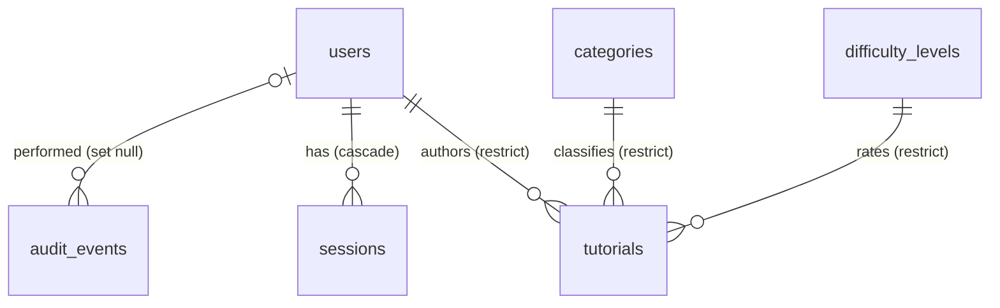

# Database

PostgreSQL 16, managed with Prisma 7 migrations (`apps/api/prisma`). Schema: `schema.prisma`;
SQL history: `migrations/`.

## Entities

| Table | Key columns | Constraints / indexes |
| --- | --- | --- |
| `users` | `username` (lower-cased), `passwordHash` (Argon2id), `role` ADMIN/OPERATOR, `status`, `name`, `email`, `dateOfBirth` (date), `gender`, `address`, `mobile` | unique `username`; index `name` |
| `sessions` | `id` uuid, `userId`, `tokenHash` char(64), `expiresAt`, `lastSeenAt` | unique `tokenHash`; index `userId`, `expiresAt`; FK cascade |
| `categories` | `title`, `titleKey`, `description`, `status` | unique `titleKey` (case/space-insensitive title) |
| `difficulty_levels` | as categories + `sortOrder` | unique `titleKey`; index `sortOrder` |
| `tutorials` | `title`, `description` (text), `prerequisites`, `status`, `categoryId`, `difficultyLevelId`, `authorId`, `createdAt`, `updatedAt` | FKs `ON DELETE RESTRICT`; indexes `(status, createdAt)`, `categoryId`, `difficultyLevelId`, `authorId`, `createdAt` |
| `audit_events` | `actorId`, `action`, `entityType`, `entityId`, `summary`, `createdAt` | index `createdAt`; FK set null |

### Legacy → modern mapping

| Legacy | Modern |
| --- | --- |
| `tbluser.usrId` | `users.username` (new surrogate `users.id`) |
| `usrPwd` (plaintext) | `passwordHash` (Argon2id) |
| `usrType` `Admin`/`Operator` | `role` `ADMIN`/`OPERATOR` |
| `usrStatus`, `categoryStatus`, … `Active`/`Inactive` | `status` `ACTIVE`/`INACTIVE` |
| `usrDOB`, `usrGender`, `usrEmail`, `usrAddress`, `usrMobile` | `dateOfBirth`, `gender`, `email`, `address`, `mobile` (optional) |
| `categoryTitle`/`categoryDesc` | `title`/`description` (+ `titleKey`) |
| `tutorialCreateDate` | `createdAt` (+ `updatedAt`) |
| `tutorialDesc`, `tutorialPrerequisites` | `description`, `prerequisites` |
| `tbltutorial.usrId` | `authorId` → `users.id` |
| — | `sessions`, `audit_events`, `difficulty_levels.sortOrder` (new) |

## Commands

| Command | Use |
| --- | --- |
| `npm run db:migrate` | **Development**: create/apply migrations from schema changes (`prisma migrate dev`) |
| `npm run db:migrate:deploy` | **Production/CI**: apply pending migrations only (`prisma migrate deploy`) |
| `npm run db:seed` | Development seed (idempotent; refuses `NODE_ENV=production`) |
| `npm run db:reset` | **Development only**: drop, re-migrate and re-seed the database in `DATABASE_URL` |
| `npm run admin:create -- --username …` | Create or reset an administrator (safe in production) |

Integration tests use `TEST_DATABASE_URL` and refuse to run unless the database name contains `test`;
end-to-end tests use `E2E_DATABASE_URL` (name must contain `e2e` or `test`). Both are dropped and
re-migrated on every run.

## Seed data

`prisma/seed-data.ts` (written for this project): 7 categories (1 inactive), 4 difficulty levels
(1 inactive), 28 tutorials spread over Mar–Sep 2026 (1 inactive tutorial, 1 in the inactive category,
1 in the inactive level → 25 public), an administrator and an operator whose usernames/passwords come
from `SEED_*` variables. Tutorials are only inserted into an empty table.

## Backups and production migrations

1. Back up first: `pg_dump --format=custom --file=mytutor-$(date +%F).dump "$DATABASE_URL"`.
2. Deploy the new release's code, then run `npm run db:migrate:deploy` (idempotent, transactional per migration).
3. Restore if needed: `pg_restore --clean --if-exists --dbname="$DATABASE_URL" mytutor-YYYY-MM-DD.dump`.

Never run `db:migrate` (dev), `db:reset` or `db:seed` against production.
