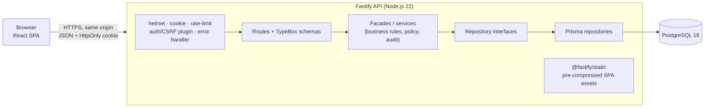

# High-level design

## Shape of the system

A **modular monolith**: one Fastify API process that also serves the built React app, backed by
PostgreSQL. No microservices, queues or caches — the catalogue is small and the operational cost would
not be justified.



In development, Vite serves the SPA on `:5173` and proxies `/api` to the API on `:3000`, so the
browser still sees a single origin and cookie/CSRF behaviour matches production.

## Repository layout

```
apps/api         Fastify API, Prisma schema/migrations/seed, admin CLI, tests
apps/web         React SPA (Vite, Tailwind 4), component tests
packages/contracts  Shared DTO types, enums, role→permission table, error codes
e2e/             Playwright journeys + disposable e2e server bootstrap
legacy/          Original PHP application (reference only, not deployed)
docs/            This documentation
```

## Technology choices

| Concern | Choice | Notes |
| --- | --- | --- |
| Frontend | React 19, React Router 7 (data router), TanStack Query 5 | Lazy-loaded admin routes |
| Styling | Tailwind CSS 4 with `@theme` design tokens | Self-hosted Manrope (OFL) |
| Motion | CSS + `IntersectionObserver` + one rAF scroll handler | No motion library needed; see below |
| API | Fastify 5 + TypeBox type provider | Request **and** response schemas |
| Data | PostgreSQL 16, Prisma 7 with `@prisma/adapter-pg` | Versioned SQL migrations |
| Passwords | Argon2id via `@node-rs/argon2` | Prebuilt binaries, no compiler needed |
| Tests | Vitest 4, Testing Library, Playwright 1.56 | |
| Tooling | npm workspaces, ESLint 9, Prettier, GitHub Actions | |

Versions are pinned in `package-lock.json`. Mature major lines were chosen deliberately over the newest
majors (TypeScript 5.9, Vite 7, React Router 7), and upgraded where `npm audit` reported advisories —
the install reports **0 vulnerabilities**.

**Motion library:** the spec allowed Motion for React “only where it adds meaningful value”. The
required effects (entrance, staggered reveal, light parallax, hover) are all achievable with CSS
transforms/opacity, one shared `IntersectionObserver` and a single passive rAF-throttled scroll
listener, so no animation dependency ships.

## Request flow

1. `onRequest`: request ID; for `/api/*` unsafe methods, Origin/Referer must be same-origin or allow-listed;
   the session cookie (if any) is resolved to an actor.
2. Route schema validates params/query/body (`additionalProperties: false`).
3. `requireAuth` / `requirePermission` pre-handler: 401/403, plus CSRF token check on mutations.
4. The facade re-asserts the permission (defence in depth), applies business rules, calls repositories.
5. The DTO is serialized through the response schema (unknown fields are dropped).
6. Errors are mapped centrally to `{ error: { code, message, details?, requestId } }`.

## Design patterns

- **Facade** — `TutorialFacade`, `UserFacade`, `DashboardFacade` expose one method per use case and
  coordinate repositories, the authorization policy and the audit logger. Routes only translate HTTP.
- **Repository** — interfaces in `modules/*/…types.ts`; Prisma implementations in
  `infrastructure/repositories/`. Unit tests use in-memory implementations (`tests/support/fakes.ts`).
- **Dependency injection** — constructor injection, wired once in the composition root `container.ts`.
  No DI framework.
- **Policy** — `AuthorizationPolicy` is the single server-side source of role decisions, driven by the
  shared `ROLE_PERMISSIONS` table in `packages/contracts`.
- **Generic service** — categories and difficulty levels share `ReferenceDataService` and one route
  factory, because the legacy screens are identical apart from labels.

## Frontend structure

```
src/app         Router, providers, error boundary
src/components  UI kit (Button, Field/TextInput/Select, DataTable, Pagination, dialogs, toasts, states)
src/features    home, tutorials (public), auth, admin/{tutorials,reference,users,account,reports}
src/hooks       useReveal, useParallax, useUnsavedChanges, useDebouncedValue, …
src/lib         API client, formatters, query client
src/styles      Design tokens and global CSS
```

- Server state lives in TanStack Query; mutations invalidate `admin` and `public` caches.
- List filters live in the URL, so reloads, sharing and the back button preserve them.
- Role information in the client only decides what to show. The API decides what is allowed.

## Motion and performance safeguards

- Reveal: elements are hidden only when *armed* by JS (motion allowed, observer available, element
  below the fold); stagger capped at 5 × 60 ms; never applied with `prefers-reduced-motion`.
- Parallax: three decorative hero layers, transform-only, updated at most once per frame, paused off
  screen, disabled for reduced motion, on screens < 768 px and on coarse pointers.
- Global reduced-motion CSS collapses all transitions/animations.
- Build output is pre-compressed (brotli + gzip) and served with immutable caching for hashed assets.

## Deployment model

Single Node process + PostgreSQL behind HTTPS (reverse proxy or PaaS). See [deployment.md](deployment.md).
