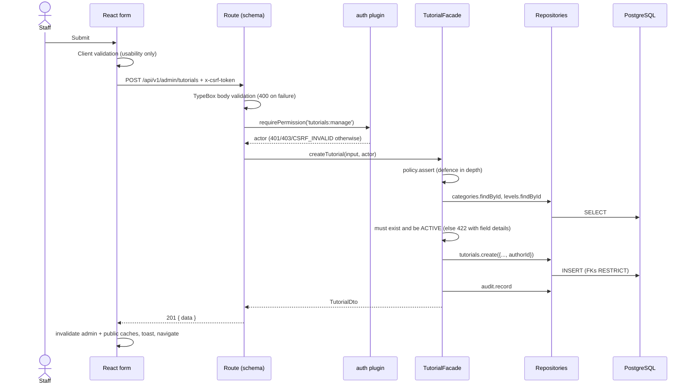

# Low-level design

## API modules (`apps/api/src`)

| Path | Responsibility |
| --- | --- |
| `config/env.ts` | Validates environment with TypeBox; fails fast; production safety checks |
| `container.ts` | Composition root — builds repositories, policy, audit logger, facades |
| `app.ts` | Fastify instance: plugins, security headers, route registration, static SPA |
| `plugins/auth.plugin.ts` | Session resolution, origin check, CSRF, `requireAuth`, `requirePermission`, cookie helpers |
| `plugins/error-handler.ts` | Maps `AppError`, schema errors and unexpected errors to the error envelope |
| `modules/auth` | `AuthService` (login, session authenticate/expire, CSRF derivation), `AuthorizationPolicy`, routes |
| `modules/tutorials` | `TutorialFacade`, types, mapper, public + admin routes |
| `modules/reference-data` | `ReferenceDataService` shared by categories and difficulty levels, routes, mappers |
| `modules/users` | `UserFacade` (admin user management, profile, change password), routes |
| `modules/reports` | `ReportService` and route |
| `modules/dashboard` | `DashboardFacade` and route |
| `modules/audit` | Audit repository interface and the logging adapter |
| `infrastructure/repositories` | Prisma implementations of every repository interface |
| `infrastructure/database` | Prisma client factory (pg adapter) and Prisma → `AppError` mapping |
| `shared/` | Errors, pagination, TypeBox schemas, text cleaning, security primitives |

## Key interfaces

```ts
interface TutorialRepository {
  listPublic(filter, sort, page): Promise<Page<TutorialRecord>>; // active tutorial + category + level
  findPublicById(id): Promise<TutorialRecord | null>;
  list(filter, sort, page): Promise<Page<TutorialRecord>>;
  findById(id): Promise<TutorialRecord | null>;
  create(data): Promise<TutorialRecord>;
  update(id, data, expectedUpdatedAt?): Promise<TutorialRecord | null>; // null = concurrent edit
  delete(id): Promise<void>;
  counts(): Promise<{ total; active; inactive }>;
}

class TutorialFacade {
  listPublicTutorials(query); getPublicTutorial(id);
  listTutorials(query, actor); getTutorial(id, actor);
  createTutorial(input, actor); updateTutorial(id, input, actor); deleteTutorial(id, actor);
}
```

`ReferenceRepository`, `UserRepository`, `SessionRepository`, `AuditRepository` and
`ReportRepository` follow the same pattern.

## Flows

### Create tutorial



### Update with optimistic concurrency

The editor sends `expectedUpdatedAt` (the `updatedAt` it loaded). The repository runs
`UPDATE … WHERE id = ? AND "updatedAt" = ?`; zero rows ⇒ `409 STALE_RECORD`, and the UI offers to
reload the latest version. Omitted fields are not touched; `prerequisites: null` clears the field.

### Sessions

1. Login: look up by normalized username (unknown users still pay an Argon2 verify to equalize timing).
2. Verify Argon2id hash; inactive accounts get `ACCOUNT_INACTIVE` only after a correct password.
3. Create a 256-bit random token; store `sha256(token)` with `expiresAt = now + SESSION_TTL_SECONDS`.
4. Set cookie `mytutor_session` (`__Host-mytutor_session` when `COOKIE_SECURE=true`), HttpOnly, SameSite=Lax, Path=/.
5. Each request: hash cookie → find session → reject if expired (and delete) or user inactive.
   `lastSeenAt` is refreshed at most once a minute.
6. CSRF token = `HMAC-SHA256(SESSION_SECRET, "csrf:" + token)`, returned by login/session endpoints,
   sent back in `x-csrf-token` on POST/PUT/PATCH/DELETE.
7. Logout deletes the session row; password change/reset and deactivation delete the user's sessions.
   An hourly timer purges expired rows.

## Error model

| Situation | Status | `code` |
| --- | --- | --- |
| Schema violation (missing/extra/invalid field, bad id) | 400 | `VALIDATION_ERROR` |
| Semantic violation (unknown/inactive reference, bad date range, wrong current password) | 422 | `VALIDATION_ERROR` |
| No/expired session | 401 | `UNAUTHENTICATED` |
| Wrong credentials | 401 | `INVALID_CREDENTIALS` |
| Inactive account (correct password) | 403 | `ACCOUNT_INACTIVE` |
| Missing/invalid CSRF token | 403 | `CSRF_INVALID` |
| Role lacks permission / disallowed origin | 403 | `FORBIDDEN` |
| Not found (or not public) | 404 | `NOT_FOUND` |
| Duplicate title/username | 409 | `CONFLICT` |
| Concurrent edit | 409 | `STALE_RECORD` |
| Record in use | 409 | `IN_USE` |
| Rate limited | 429 | `RATE_LIMITED` |
| Anything else | 500 | `INTERNAL_ERROR` (logged with request ID; no internals returned) |

## Frontend data flow

- `lib/api.ts`: one fetch wrapper — base URL, JSON, `credentials: 'same-origin'`, CSRF header on
  mutations, `ApiError` with `fieldErrors()`, global 401 hook that clears the session.
- `features/auth/session.tsx`: `GET /auth/session` on load; `login`/`logout`; `can(permission)`.
- `RequireAuth` redirects to `/login` with the return path; `safeRedirect` accepts only in-app paths.
- Forms validate on submit, then display server field errors; buttons disable while pending; inputs
  are preserved on failure; the tutorial editor blocks navigation with unsaved edits.
